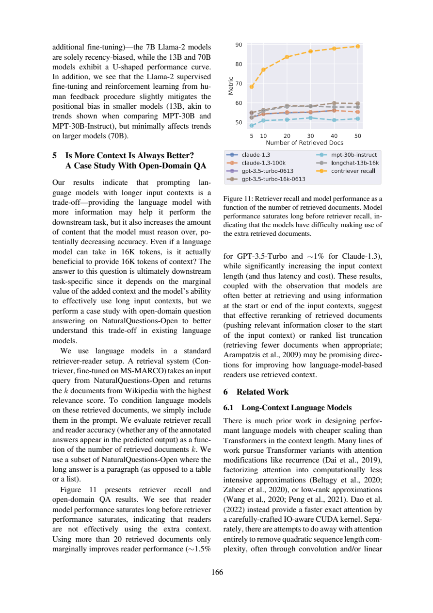

# 检索召回上升，为什么答案未必更准

这份分享解决一个具体的论文阅读问题，采用“先冻结问题与验收标准→编号原文→真实AI回答→严格定位→语义核查”的流程。范围、任务和作者判断在下文明确分开；不是对原论文实验的复现，也没有宣称模型、提示词或工作流普遍更优。此前我在同项目阅读过这两篇论文；本次主题与既有query位置干预文章不同，实际调用也是新产生的。

## 先区分实验，再区分指标

《Lost in the Middle》物理页3（印刷159）§2.1的受控multi-document QA保证恰好一个文档含标注答案，其余为干扰文档。页3脚注同时提醒NaturalQuestions的歧义可能使少量干扰段落含合理答案。不能把“按标注构造”说成对所有合理答案的逻辑排除。

§5物理页10（166）的open-domain QA则直接取Contriever在Wikipedia上的top-k；这些文档可能零个或多个含答案。这意味着受控位置实验和自然检索增加k不是同一干预，不能把两者的曲线拿来作公平收益对比。

|阶段|要检查的事件|不能由它保证什么|
|---|---|---|
|检索器recall|检索集合是否覆盖标注答案（集合层面）|阅读器最终真的利用它|
|reader accuracy|预测输出是否出现任何标注答案，论文在§5明确如此定义|没有额外错误、完整解释或所有主张都有证据|

第一行是对该检索指标的操作性解读；所供页未给完整数学公式或规范化代码，因此不额外声称复现了作者计分脚本。第二行是原文明确给出的字符串命中判据，也不是通用事实正确性保证。



Figure11横轴为检索文档数5到50，纵轴Metric；黄色Contriever recall继续上升，模型reader曲线较早趋平。正文及页3概述说50对20文档仅边际改善，GPT-3.5-Turbo约1.5%、Claude-1.3约1%。这里保留作者近似记法，不从图像反算新点值，不在缺少20文档精确基数时计算相对提升率。图的指标在百分比刻度上，跨两条件差值与相对提升的分母不同；若要严格报告百分点，应取作者原始评测数值再确认。

## 新调用的可用部分与缺口

原答D1正确区分恰好一份与可零/多份，D2指出预测输出中的答案命中，D3没有发明绝对accuracy或相对增长率，D4保留“may be promising directions”的建议性质。这些核心解释与原文一致。但D1漏了歧义脚注；D2只命名检索recall，没有展开检索覆盖事件或分母，不能直接拿它实现指标。

证据也不完全贴合：D1引用P3:58–66覆盖受控输入定义，却不足以支持其后关于标注段落和干扰文档的构造细节，需68–98。D2 P10:38–41覆盖reader指标定义，46–50也充分覆盖饱和观察；这两处定位有效，但检索recall本身仍未展开。D4给的62–69覆盖建议主体，却在完整句末70之前结束，应连读60–70。通过范围检查并不消除这些缺口。

原文把reranking和适当truncation列为未来可能方向，并未在该节给出产品收益验证；也没有证明20是所有模型或任务最优。我的应用判断是应分别记录检索覆盖、阅读结果和上下文负担，再在目标数据上选k；这只是从指标拆解得到的工程建议，本次没有部署测量、成本测量或论文GPU复现。

## 真实记录与复做

本次一轮Bohrium CLI2.8.1原生调用，请求gpt-5-mini/photon，实际返回chenkun/gpt-5-mini。无历史无工具，180秒预算，实际墙钟（含预检及客户端开销）19.954秒，输入2498、输出2546 tokens。completion ID见metadata；精确snapshot/temperature/seed不可得。费用无逐次货币信息，cost=null，不能当0。正文判断由Codex辅助非盲核查，不伪装独立人类评审。

完整[实际输入](run-request.txt)、[预检](run-preflight.json)、[原始响应](run-response.json)、[模型原答](run-output.json)、[元数据](run-metadata.json)、[stderr](run-stderr.txt)均保留。response仅脱敏私人余额。没有重写原答，也没有失败后挑选新答案。本次严格JSON/行范围结果为`ranges_valid`，共9段；这只检查id覆盖、字段存在与行范围，不检测问题语义对应、单位、蕴含或原文是否充分。

本地复查（Python3标准库、无需联网）：

```sh
python validate.py sources.json run-output.json
```

预期ranges_valid，exit0；请继续逐项比对[编号原文](numbered.txt)、正文审计与[调用前标准](criteria.md)。D1–D4标签存在不表示它们分别答对了问题。

独立重做需从玻尔官方渠道安装Bohrium CLI并手动登录，确保额度。保留这些文件同目录，用原生exe或对应系统原生二进制：

```sh
python replay.py --bohr /absolute/path/to/bohr --condition workflow --out new-run
```

replay先dry-run逐字验证实际message，再调用；现有out拒绝覆盖。Windows .cmd历史上会截断多行参数，原生exe避免这一已遇到的问题；命令行仍需低于Windows长度限制。若代理影响认证，本脚本仅移除子进程HTTP_PROXY/HTTPS_PROXY/ALL_PROXY及小写变量，不修改系统代理。真实输入含非语义UUID，新调用不保证逐字相同，按预先标准核验。失败记录不应删改，网络失败不得伪造成功。

## 文件导航与许可

[task.txt](task.txt)列出确切四项问题；[workflow.txt](workflow.txt)为本次方法；[protocol.md](protocol.md)为运行约束；[protocol-lock.json](protocol-lock.json)记录六个事前文件SHA256（对应本目录同名文件）。[sources.json](sources.json)保留原文页面、物理页和source_id，[SOURCES.md](SOURCES.md)说明作者、版本、页码、原PDF哈希与许可。图是原页核查材料，关键结论都另有文字，不依赖看图取数。

[validate.py](validate.py)是机械检查器；[replay.py](replay.py)保存全新请求与响应。只有本次输入输出进入本作品，未把旧实验重复包装。论文采用CC-BY4.0，原创文字与代码MIT。来源研究归论文作者；本次贡献是具体问题设计、适配编号流程、一次实际玻尔阅读、对原答缺陷的原文核查及可照做教程。
